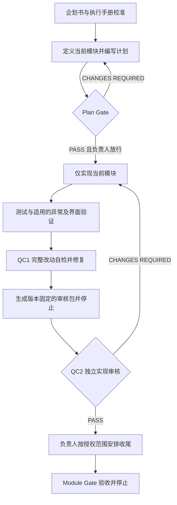

# Modular-Dev-Quality-SOP

**A standard workflow for AI-assisted modular development and dual-QC auditing.**

一套基于 AI 辅助的模块化开发与双重质检标准化工作流。

> 一次只做一个模块，用可检查的证据交付，用明确的门槛推进。

## 这套工作流解决什么问题

当目标项目（Target Project）逐渐变大，仅靠一段长 Prompt 很难持续约束范围、保留依据和完成交接。本仓库把个人实践整理为可复用的标准作业程序（SOP）：先确定长期方向，再拆成独立模块，由开发端实现与自检，由审核端独立检查，项目负责人控制阶段放行。

适用于需要分阶段交付的业务系统、内部工具、内容平台或其他软件项目。Codex 与 GPT 是本文的默认角色示例，可以替换为具备相应能力的工具或人员。

本仓库仅包含 Markdown 方法论、操作指南和 Prompt 模板。它不提供业务系统代码，也不代表任何认证或已经验证的质量提升比例。

## 核心方法：模块化生产，双重质检

| 方法 | 在开发中的具体做法 |
| --- | --- |
| 标准作业 | 固定输入、步骤、交付物和验收条件，减少重复解释 |
| 小批量交付 | 一次只实现一个 Module（模块），过大时先在模块内部拆分 |
| 在制品限制 | 当前模块未通过验收，不开始下一模块；多个会话用于隔离上下文 |
| 质量内建 | 开发端执行测试、异常验证和完整改动自检，不把缺陷全部留给审核端 |
| 独立质检 | 审核端检查原始改动与证据，而非只阅读完成摘要 |
| 持续改进 | 将已经验证、适用条件清楚的经验写入 Skill；清理过时规则 |
| 可追溯 | 每次审核绑定文档版本、改动基线和审核包版本 |

**双重质检（Dual-QC）** 指两道互补的检查：

- **QC1：开发端自检。** Codex 检查当前模块的完整改动，修复问题并重新验证。
- **QC2：独立实现审核。** GPT 或独立审核人员检查同一版本的实现、测试与审核包，给出明确结论。

写代码前另设 **Plan Gate（计划门槛）**，提前审核范围、方案和测试设计。自检通过不能替代独立审核；审核 `PASS ✅` 只对注明的阶段与版本有效，阶段推进仍由项目负责人放行。两道检查也可能遗漏同类问题，因此验收必须依赖证据，不能只依赖模型意见。

## 工作流总览



如目标项目采用 PR（拉取请求），收尾包括提交、推送、PR 审核、持续集成检查、合并和合并后验证；按项目约定与负责人授权执行。图中的停止点不会自动触发这些操作或下一模块。

## 从这里开始

1. 用[项目长期企划书指南](docs/01_Project_Plan_Guide.md)为 `[项目名称]` 建立目标、范围、架构和模块路线。
2. 阅读[开发流程与执行手册](docs/02_Execution_Manual.md)及[事实来源政策](docs/03_Source_of_Truth_Policy.md)，让开发端与审核端先校准两份项目基线文件。
3. 为当前模块分别创建开发会话与审核会话，填入相同的模块编号、文档版本、依赖和验收标准。
4. 将[开发 Prompt](prompts/Developer_Prompt_Template.md)发给 Codex；将[审核 Prompt](prompts/Reviewer_Prompt_Template.md)发给 GPT，并选择 `PLAN` 阶段。
5. 计划审核通过且负责人放行后实现；完成 QC1 后提交审核包，将审核阶段改为 `IMPLEMENTATION`，执行 QC2。
6. 不通过则修复、重新验证、生成新版审核包并重审；通过后按授权收尾，经 Module Gate 验收后停止。

**首次采用时**，先完成两份项目基线文件，再从一个边界清楚的小模块试行。只需填写当前模块的信息，不必一次填完所有未来模块。

## 文档导航

| 入口 | 用途 |
| --- | --- |
| [长期企划书指南](docs/01_Project_Plan_Guide.md) | 系统要做什么，边界在哪里，怎样拆模块 |
| [执行手册 SOP](docs/02_Execution_Manual.md) | 开发顺序、阶段门槛、审核包、交接与验收 |
| [事实来源与冲突处理](docs/03_Source_of_Truth_Policy.md) | 资料怎么查、怎么留证、冲突怎么解决 |
| [开发端 Prompt](prompts/Developer_Prompt_Template.md) | 可复制的计划、实现、自检与交付约束 |
| [审核端 Prompt](prompts/Reviewer_Prompt_Template.md) | 可复制的审核标准、结论与修复 Prompt |
| [独立案例目录](examples/) | 观察方法如何适配具体项目；案例规则不自动成为通用规则 |
| [贡献指南](CONTRIBUTING.md) | 文档修改、模板改进与案例贡献要求 |
| [许可](LICENSE.md) | CC BY 4.0 许可声明与完整条款 |

`docs/` 是方法指南，`prompts/` 是通用模板，`examples/` 是独立案例。指南中提到的项目状态、路线图和审核记录，应在**目标项目**内维护；本仓库不会预置一个虚构项目的开发进度。

## 不可跳过的约束

- 一次只做当前模块；范围变化先修改计划并重新审核。
- 读取最新且适用于所用版本的官方资料；经验、示例和模型记忆不能覆盖权威依据。
- 涉及高风险写操作时采用 Fail-Closed：前置条件不满足或结果未知时阻止新增高风险操作；未知结果先核实，不盲目重试。
- 如实区分 `PASS`、`FAIL`、`NOT RUN` 和 `NOT APPLICABLE`；缺少必要证据时不能给出通过结论。
- 审核后的任何相关改动都需要更新证据并重新审核；完成一个模块不等于可以自动推进。

## GitHub 仓库信息

仓库名：`Modular-Dev-Quality-SOP`

Description（可直接复制）：

```text
A standard workflow for AI-assisted modular development and dual-QC auditing. (一套基于 AI 辅助的模块化开发与双重质检标准化工作流)
```

Topics（英文空格分隔，可直接复制）：

```text
industrial-engineering lean-production sop quality-control modular-design ai-workflow prompt-engineering
```

## 许可与署名

工作流设计与原始说明：**Justin（justinchang9562）**。文档经 AI 辅助整理；AI 输出仍须由使用者核验。

Copyright © 2026 Justin（justinchang9562）。

本仓库原创文档与 Prompt 模板采用 [CC BY 4.0](https://creativecommons.org/licenses/by/4.0/)：允许分享和改编，包括商业用途；须适当署名、提供许可链接并说明修改，不得暗示原作者背书。完整条款见 [LICENSE.md](LICENSE.md)。外部资料与第三方名称的权利按各自声明处理。
